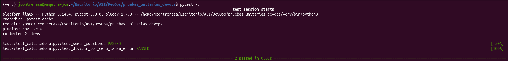
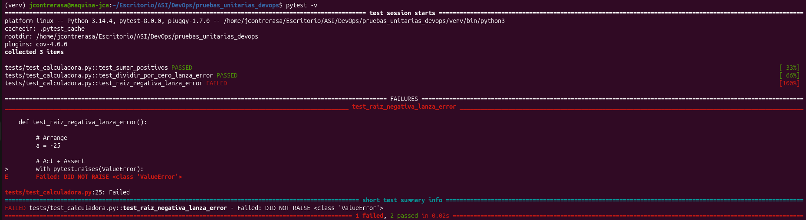
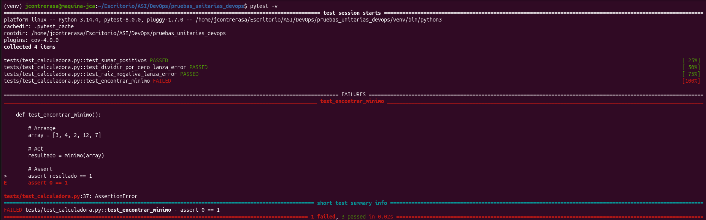
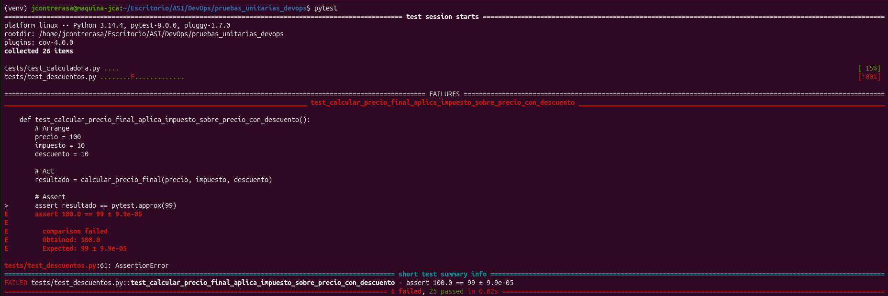
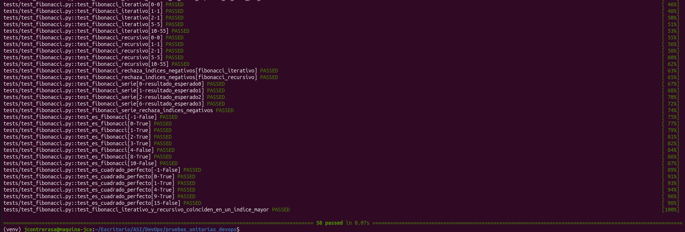

# Análisis y desarrollo de pruebas unitarias con Pytest

**Introducción a DevOps · Laboratorio**
Universidad Nacional de Colombia, Sede Manizales

## 1. Datos del informe

- **Estudiante:** Jacobo Contreras Arango
- **Fecha:** 17 de octubre de 2026
- **Repositorio:** https://github.com/jcontrerasa9/pruebas_unitarias_devops

## 2. Introducción

Este informe documenta el trabajo de pruebas unitarias realizado sobre el repositorio `pruebas_unitarias_devops`. El objetivo fue escribir pruebas con pytest, encontrar errores ocultos en el código fuente (`src/`) y corregirlos.

Todas las pruebas siguen la estructura AAA, que divide cada prueba en tres pasos:

- **Arrange:** se preparan los datos de entrada y el resultado esperado.
- **Act:** se llama a la función que se está probando.
- **Assert:** se compara el resultado obtenido con el esperado.

Se trabajaron tres módulos: calculadora y descuentos (obligatorios) y fibonacci. Las pruebas se ejecutaron con `pytest -v` desde la raíz del repositorio.

## 3. Análisis por módulo

### 3.1 Módulo calculadora (`src/calculadora.py`)

Contiene operaciones matemáticas básicas: `sumar`, `dividir`, `raiz_cuadrada` y `minimo`. Se eligieron casos normales y casos límite donde una función suele fallar (cero, negativos, valores iniciales).

| Prueba | Entrada | Por qué se probó |
|---|---|---|
| `test_sumar_positivos` | 7 + 5 → 12 | Caso normal de referencia. |
| `test_dividir_por_cero_lanza_error` | `dividir(10, 0)` | Caso límite: división por cero debe lanzar `ValueError`. |
| `test_raiz_negativa_lanza_error` | `raiz_cuadrada(-25)` | Una raíz real no existe para negativos. |
| `test_encontrar_minimo` | `[3, 4, 2, 12, 7]` → 2 | Lista de valores positivos: revela errores en el valor inicial. |

Primero se escribieron las dos pruebas iniciales y ambas pasaron (Figura 1).


*Figura 1. Las dos primeras pruebas de calculadora pasan (2 passed).*

Al agregar la prueba de la raíz cuadrada con un número negativo, falló con el mensaje `DID NOT RAISE`: la función no lanzó `ValueError` (Figura 2). Esto reveló el Bug 1.


*Figura 2. La prueba de raíz con -25 falla: la función no lanza ValueError.*

Tras corregir ese error, la prueba de raíz pasó. Luego se agregó la prueba del mínimo, que falló porque la función devolvió 0 en lugar del menor valor de la lista (Figura 3). Esto reveló el Bug 2.


*Figura 3. Con la raíz corregida, la prueba de minimo falla: la función devuelve 0.*

### 3.2 Módulo descuentos (`src/descuentos.py`)

Calcula descuentos y precios finales mediante las funciones `aplicar_descuento`, `descuento_apilado` y `calcular_precio_final`. Se probaron precios y porcentajes normales, valores límite y entradas inválidas.

En la ejecución de 26 pruebas (calculadora y descuentos), una falló: `calcular_precio_final` con precio 100, impuesto 10 % y descuento 10 %. Se espera aplicar el descuento primero (100 → 90) y luego el impuesto sobre ese valor (90 + 9 = 99), pero la función devolvió 100.0 (Figura 4). Esto reveló el Bug 3.


*Figura 4. Fallo en calcular_precio_final: se obtuvo 100.0 y se esperaba 99.*

**Falso positivo en `descuento_apilado`.** El código incluye el comentario `BUG 2`, que advierte que el descuento total puede superar el 100 %:

```python
def descuento_apilado(precio, descuentos):
    ...
    total_descuento = sum(descuentos)
    # BUG 2: El descuento total puede exceder el 100%
    return aplicar_descuento(precio, total_descuento)
```

Al revisar el código se concluyó que no es un bug real: la función delega el cálculo en `aplicar_descuento`, que ya valida el porcentaje. Por eso no se cuenta entre los bugs encontrados.

### 3.3 Módulo fibonacci (`src/fibonacci.py`)

Implementa la sucesión de Fibonacci de forma iterativa y recursiva, además de funciones auxiliares (`fibonacci_serie`, `es_fibonacci` y `es_cuadrado_perfecto`). Se usaron pruebas parametrizadas para cubrir varios valores con una sola función de prueba.

| Grupo de pruebas | Casos cubiertos |
|---|---|
| `fibonacci_iterativo` y `fibonacci_recursivo` | Índices 0, 1, 2, 5 y 10 (resultado 55). |
| Rechazo de índices negativos | Ambas versiones lanzan error con índices negativos. |
| `fibonacci_serie` | Series de longitud 0, 1, 2 y 6, y rechazo de negativos. |
| `es_fibonacci` | Valores -1, 0, 1, 2, 3, 4, 8 y 10. |
| `es_cuadrado_perfecto` | Valores -1, 0, 1, 4, 9 y 15. |
| Consistencia | La versión iterativa y la recursiva coinciden en un índice mayor. |

Además, a `fibonacci_recursivo` se le aplicó memoización con un diccionario (`memo`): antes de calcular un valor se busca en el diccionario y, si ya existe, se reutiliza; si no, se calcula y se guarda. Así cada índice se calcula una sola vez y el costo pasa de exponencial a lineal. Es una mejora de rendimiento, no un bug: los resultados no cambian y las pruebas, incluida la que compara la versión iterativa con la recursiva, siguen pasando.

Al ejecutar todas las pruebas del proyecto, las 58 pasaron (Figura 5).


*Figura 5. Resultado final: 58 passed in 0.07s.*

## 4. Tabla de bugs

| # | Función | Entrada | Resultado erróneo | Resultado esperado | Corrección |
|---|---|---|---|---|---|
| 1 | `raiz_cuadrada` | `-25` | Un número complejo (≈ 5j) en vez de un error | `ValueError` | Validar que el número no sea negativo y lanzar `ValueError` antes de calcular. |
| 2 | `minimo` | `[3, 4, 2, 12, 7]` | 0 (valor que ni está en la lista) | 2 | Inicializar el mínimo con un elemento de la lista en vez de 0. |
| 3 | `calcular_precio_final` | precio=100, impuesto=10, descuento=10 | 100.0 | 99 | Calcular el impuesto sobre el precio con descuento ya aplicado. |

El Bug 2 ocurre siempre que todos los elementos son mayores que 0, porque nadie es menor que el valor inicial 0. Con números negativos la función sí funcionaba, lo que lo hacía difícil de notar.

## 5. Cobertura

La cobertura mide qué porcentaje de las líneas de `src/` ejecutan las pruebas. Se mide con el comando:

```bash
pytest tests/ -v --cov=src --cov-report=term-missing
```

Salida del reporte (ejecución final):

```
---------- coverage: platform linux, python 3.12.3-final-0 -----------
Name                       Stmts   Miss  Cover   Missing
--------------------------------------------------------
src/__init__.py                0      0   100%
src/autenticacion.py          42     42     0%   6-77
src/calculadora.py            44      5    89%   32, 43, 47, 53, 69
src/conversor.py              56     56     0%   6-94
src/csv_parser.py             76     76     0%   6-127
src/descuentos.py             58      3    95%   74, 91, 94
src/fibonacci.py              48      0   100%
src/manipulador_texto.py      93     93     0%   6-156
src/procesador_texto.py       49     49     0%   6-84
src/utils.py                  53     53     0%   6-92
src/validador.py              64     64     0%   6-117
--------------------------------------------------------
TOTAL                        583    441    24%
```

En la ejecución final pasan las 80 pruebas. En los tres módulos trabajados se superó la meta del 85 %: fibonacci llegó a 100 %, descuentos a 95 % y calculadora a 89 %. Al inicio calculadora estaba en 50 % y descuentos en 76 %, y subieron al agregar pruebas para las funciones y las ramas de error que ningún test ejecutaba.

Las líneas que siguen sin cubrir (columna Missing) son la 32, 43, 47, 53 y 69 en calculadora, y la 74, 91 y 94 en descuentos. El total del proyecto es 24 % porque los otros siete módulos (autenticacion, conversor, csv_parser, manipulador_texto, procesador_texto, utils y validador) no se trabajaron en este taller y quedan en 0 %.

## 6. Reflexión final

### ¿Qué no mide la cobertura?

La cobertura solo indica qué líneas se ejecutaron, no si el resultado es correcto. En este taller, `minimo` arrancaba con `min_val = 0`: una prueba con la lista `[-2, 5]` ejecuta todas las líneas de la función y pasa, aunque la función falla con listas de valores positivos. Con esa única prueba la cobertura sería de 100 % y el bug seguiría ahí. Tampoco mide la calidad de los `assert` ni cuántas entradas distintas se probaron: una línea cuenta como cubierta con una sola entrada, aunque otras la rompan. Por eso el 100 % de fibonacci no garantiza que la función esté libre de errores en los casos que no probé.

### ¿Qué aprendí?

Aprendí a estructurar cada prueba con AAA, lo que deja claro qué se prepara, qué se ejecuta y qué se verifica. También aprendí que los errores aparecen con los casos límite y no con los casos normales: los tres bugs salieron con un número negativo (`raiz_cuadrada`), con una lista de valores positivos (`minimo`) y con la combinación de descuento e impuesto (`calcular_precio_final`). Una prueba en rojo no siempre indica un error del código: antes de corregir hay que definir cuál es el resultado correcto, y en una de mis pruebas el valor esperado estaba mal (esperaba 1 como mínimo de `[3, 4, 2, 12, 7]`, cuando el valor correcto es 2). Además, el historial de commits muestra el proceso, porque en cada bug primero subí la prueba que fallaba y después el fix. La columna Missing de la cobertura también me sirvió como guía para saber qué pruebas faltaban.
